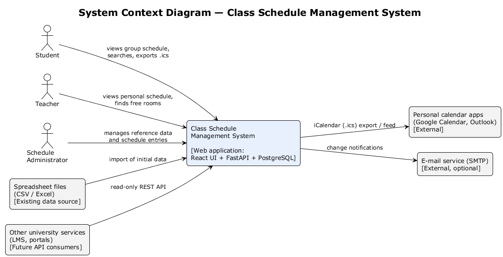
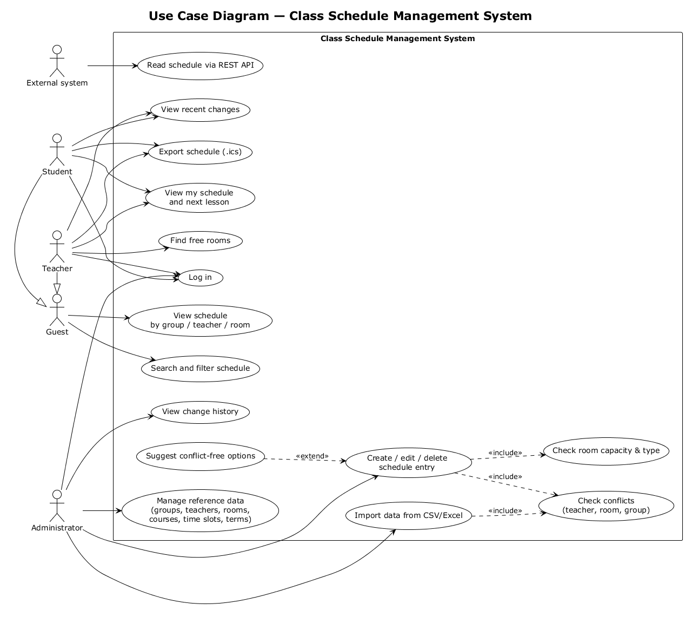
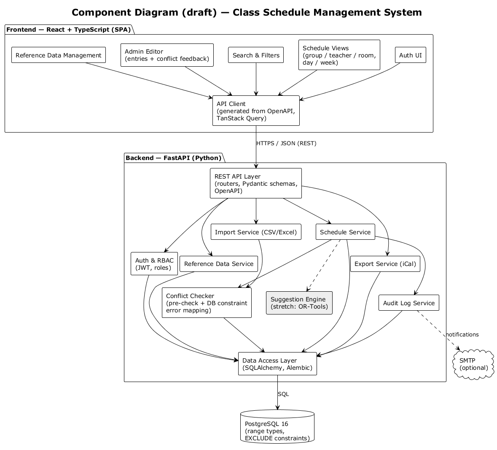
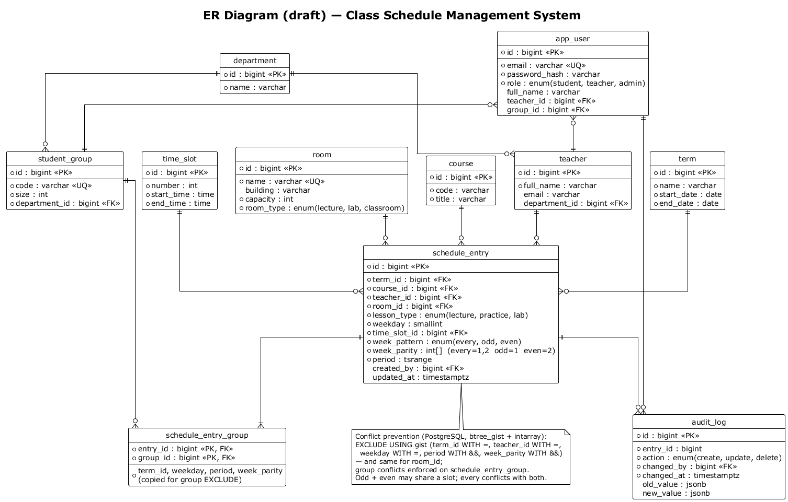

# Architecture and Diagrams

Editable sources are in [`diagrams/src`](../diagrams/src) (PlantUML), exports in [`diagrams/export`](../diagrams/export) (PNG, SVG).
To regenerate: `java -jar plantuml.jar -tpng -o ../export diagrams/src/*.puml`.

## 1. Architectural overview

The system follows a **three-tier client–server architecture**:

1. **Presentation tier** — a React + TypeScript single-page application served as static files. It communicates with the backend only through the REST API.
2. **Application tier** — a FastAPI service organised in layers: API layer (routers, request/response schemas) → service layer (business rules) → data access layer (SQLAlchemy repositories).
3. **Data tier** — PostgreSQL 16, which is not only storage but also the final guard of schedule consistency through constraints.

All three tiers run as containers orchestrated by Docker Compose.

**Key architectural decisions**

| ID | Decision | Rationale | Related requirements |
|---|---|---|---|
| AD-1 | Contract-first REST API described by OpenAPI; frontend client generated from it | Backend and frontend are developed in parallel by different students; the spec is the single source of truth | FR-14, NFR-07 |
| AD-2 | Conflict prevention enforced by PostgreSQL `EXCLUDE` constraints, with an application-level pre-check for user-friendly messages | Application-only checks are vulnerable to race conditions between concurrent edits; DB constraints are atomic | FR-08, NFR-03 |
| AD-3 | Stateless backend with JWT and role-based authorisation dependencies | Simple horizontal scaling, clear permission checks per endpoint | FR-01, FR-02, NFR-04 |
| AD-4 | Audit log written in the same transaction as the schedule change | Change history is always consistent with the data | FR-15, FR-17 |
| AD-5 | Layered backend (API / service / data access) | Business rules are testable without HTTP and without the real DB | NFR-07 |

## 2. System context



The system is used by three human roles (student, teacher, administrator). It exchanges data with personal calendar applications (iCal export), optionally sends e-mail through SMTP, imports existing data from spreadsheets, and exposes a read-only REST API for future university services.

## 3. Use cases



| Use case | Actor(s) | Requirements |
|---|---|---|
| UC01 Log in | Student, Teacher, Admin | FR-01, FR-02 |
| UC02 View schedule by group/teacher/room | Guest and above | FR-10 |
| UC03 Search and filter | Guest and above | FR-11 |
| UC04 View my schedule and next lesson | Student, Teacher | FR-12 |
| UC05 Find free rooms | Teacher | FR-13 |
| UC06 Export schedule (.ics) | Student, Teacher | FR-16 |
| UC07 View recent changes | Student, Teacher | FR-17 |
| UC08 Manage reference data | Admin | FR-03 – FR-06 |
| UC09 Create/edit/delete schedule entry | Admin | FR-07 |
| UC10 Check conflicts (included) | — | FR-08, NFR-03 |
| UC11 Check room capacity & type (included) | — | FR-09 |
| UC12 View change history | Admin | FR-15 |
| UC13 Import from CSV/Excel | Admin | FR-18 |
| UC14 Suggest conflict-free options (extends UC09) | Admin | FR-19 |
| UC15 Read schedule via REST API | External system | FR-14 |

### Main scenario — UC09 "Create schedule entry"

1. Admin opens the editor and selects term, group(s), course, lesson type, teacher, day, time slot, week pattern and room.
2. Frontend sends `POST /api/v1/schedule-entries`.
3. Backend validates input and RBAC (admin only).
4. Schedule Service performs a pre-check for teacher, room and group conflicts and capacity/type mismatch.
5. Entry and audit record are inserted in one transaction; PostgreSQL `EXCLUDE` constraints guarantee no overlap.
6. Backend returns `201 Created`; the entry appears in all related views.

**Alternative flows**
- 4a/5a. Conflict detected → `409 Conflict` with the conflicting entry (who/what/where) → UI highlights the conflicting field and suggests free alternatives (FR-19, optional).
- 4b. Capacity or room type mismatch → `422` warning; admin may confirm and resend with `force_capacity=true`.

## 4. Components (draft)



| Component | Responsibility | Owner |
|---|---|---|
| Auth UI, Schedule Views, Search & Filters, Admin Editor, Reference Data Management | User-facing screens | Nurzhaina |
| API Client | Typed client generated from OpenAPI, caching with TanStack Query | Nurzhaina |
| REST API Layer | Routing, validation, OpenAPI generation, error format | Zeyin |
| Auth & RBAC | Login, JWT issuing/validation, role checks | Zeyin |
| Reference Data Service | CRUD for groups, teachers, rooms, courses, terms, time slots | Zeyin |
| Schedule Service | Schedule entry lifecycle, queries for views and free rooms | Zeyin |
| Conflict Checker | Pre-checks and mapping of DB constraint violations to readable 409 responses | Zeyin |
| Audit Log Service | Change history, recent-changes feed | Zeyin |
| Export Service | iCalendar generation | Zeyin |
| Import Service | CSV/Excel import with validation | Zeyin (C priority) |
| Suggestion Engine | Conflict-free options; stretch: OR-Tools CP-SAT | Zeyin (stretch) |
| Data Access Layer | SQLAlchemy models, repositories, Alembic migrations | Zeyin |

## 5. Data model (draft)



**Conflict prevention at database level (concept):**

```sql
CREATE EXTENSION IF NOT EXISTS btree_gist;  -- '=' on scalar columns inside GiST
CREATE EXTENSION IF NOT EXISTS intarray;    -- '&&' on integer arrays inside GiST

-- week_parity is derived from week_pattern: every = {1,2}, odd = {1}, even = {2}
-- period is the lesson's time range within the day (e.g. tsrange of the time slot)

-- A teacher cannot have two overlapping lessons on the same weekday in the same term
ALTER TABLE schedule_entry
  ADD CONSTRAINT no_teacher_overlap
  EXCLUDE USING gist (
    term_id     WITH =,
    teacher_id  WITH =,
    weekday     WITH =,
    period      WITH &&,
    week_parity gist__int_ops WITH &&
  );
-- The same constraint is defined for room_id, and for group_id on schedule_entry_group.
-- Result: an 'odd' and an 'even' lesson may share a slot, 'every' conflicts with both,
-- and the rule holds even for concurrent transactions (violation -> SQLSTATE 23P01 -> HTTP 409).
```

## 6. API outline (draft)

| Method | Endpoint | Role | Description |
|---|---|---|---|
| POST | `/api/v1/auth/login` | any | Obtain tokens |
| GET | `/api/v1/schedule?group_id=&teacher_id=&room_id=&week=` | guest+ | Schedule for a view |
| GET | `/api/v1/me/schedule` | student, teacher | Personal schedule |
| GET | `/api/v1/rooms/free?weekday=&slot=&type=&min_capacity=` | teacher+ | Free rooms |
| GET/POST/PUT/DELETE | `/api/v1/groups`, `/teachers`, `/rooms`, `/courses`, `/terms`, `/time-slots` | admin (write) | Reference data |
| POST/PUT/DELETE | `/api/v1/schedule-entries` | admin | Manage entries (409 on conflict) |
| GET | `/api/v1/schedule-entries/{id}/history` | admin | Audit log |
| GET | `/api/v1/changes/recent` | student, teacher | Recent changes |
| GET | `/api/v1/export/ics?group_id=` | guest+ | iCalendar export |

Error format (all endpoints): `{ "error": { "code": "SCHEDULE_CONFLICT", "message": "...", "details": {...} } }`.

## 7. Alignment check

| Requirement | Use case | Component | Data | Test (see 09) |
|---|---|---|---|---|
| FR-08 Conflict prevention | UC09, UC10 | Schedule Service, Conflict Checker | `schedule_entry` EXCLUDE constraints | T-INT-03, T-CON-01 |
| FR-10 Views | UC02 | Schedule Views, Schedule Service | `schedule_entry` + joins | T-E2E-01 |
| FR-13 Free rooms | UC05 | Schedule Service | `room`, `schedule_entry` | T-INT-05 |
| FR-15 History | UC12 | Audit Log Service | `audit_log` | T-INT-06 |
| FR-16 iCal | UC06 | Export Service | `schedule_entry` | T-INT-07 |
