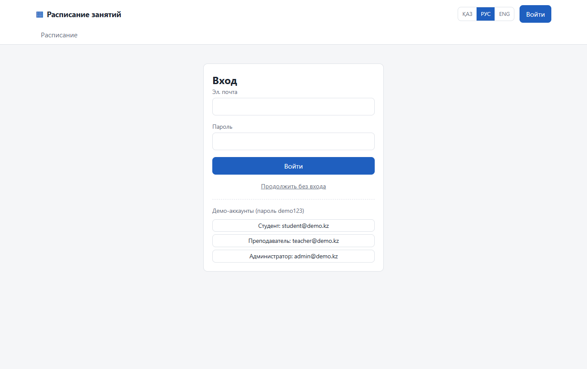
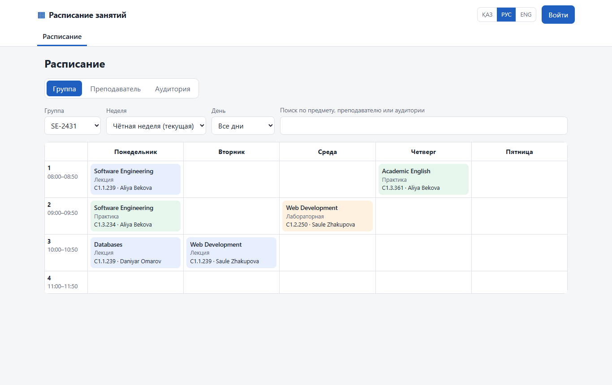
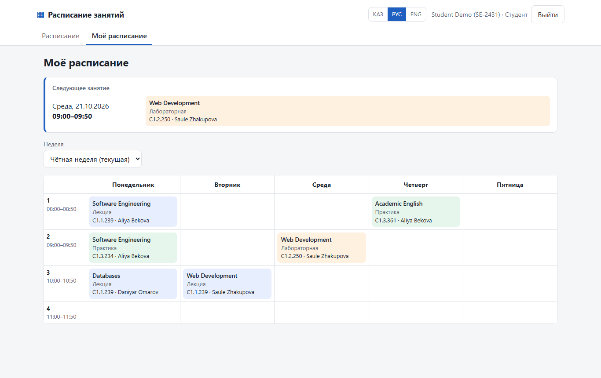
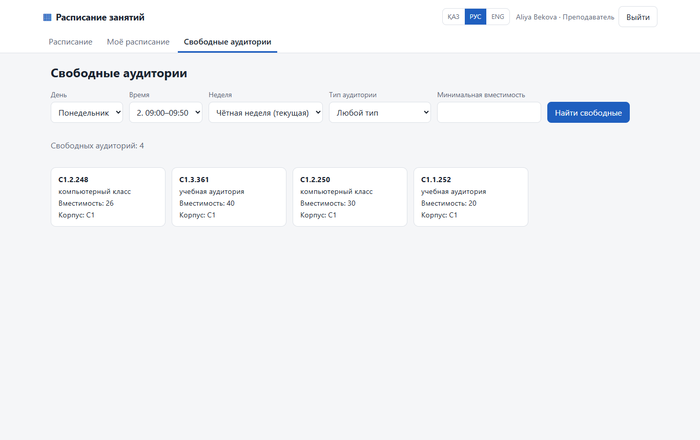
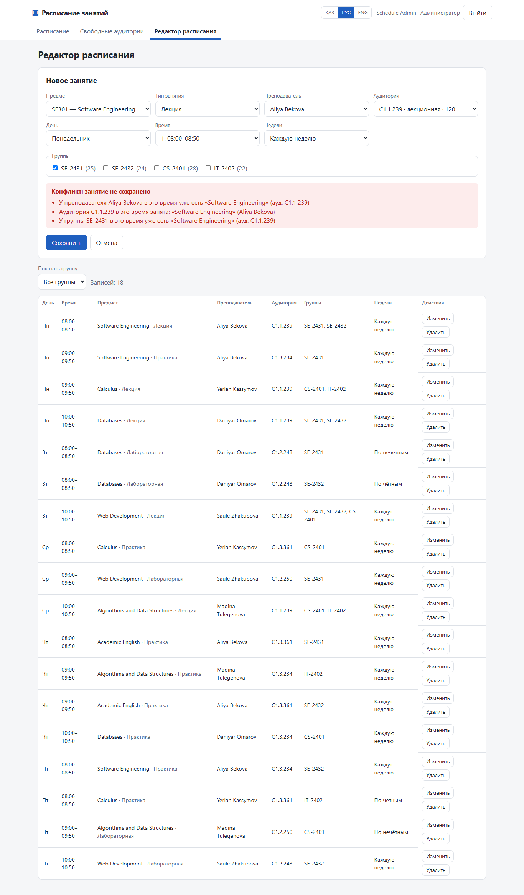
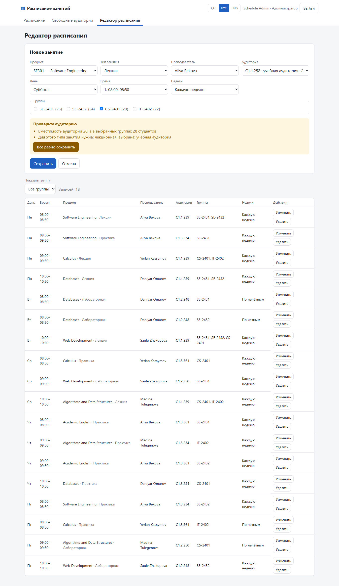
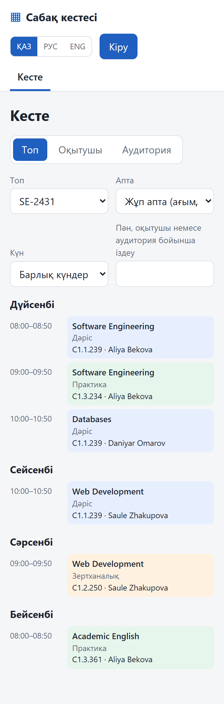

# UX / Prototype

**Owner:** Nurzhaina Kuralbay (Frontend, UI/UX)
**Figma link:** _TODO_
**Working prototype:** [`src/frontend`](../src/frontend) — React application running on a mock API (see [How to run](#5-how-to-run-the-prototype)).

The prototype covers the key scenarios of all three roles. Until the backend is available (milestone M2), the frontend uses an in-browser mock that follows the same REST contract and error format as the planned API (`docs/07-architecture.md`, section 6), including conflict detection with odd/even weeks. Switching to the real backend only requires `VITE_USE_MOCK=false`.

## 1. Key user scenarios

| # | Scenario | Actor | Use case | Requirements | Screen |
|---|---|---|---|---|---|
| S1 | Find my group's schedule for the current week on a phone | Student / Guest | UC02, UC03 | FR-10, FR-11, NFR-05 | 2, 7 |
| S2 | See my personal schedule and the next lesson after logging in | Student, Teacher | UC01, UC04 | FR-01, FR-12 | 1, 3 |
| S3 | Find a free room of a given type and size for a time slot | Teacher | UC05 | FR-13 | 4 |
| S4 | Add a lesson and get an immediate, readable message about a double booking | Admin | UC09, UC10 | FR-07, FR-08 | 5 |
| S5 | Get a warning when the room is too small or of the wrong type, and decide whether to save | Admin | UC11 | FR-09 | 6 |
| S6 | Use the interface in Kazakh, Russian or English | All | — | NFR-10 | 7 |

### S4 step by step (main scenario of the project)

1. The administrator opens **Schedule editor** and presses **New entry**.
2. Selects course, lesson type, teacher, room, day, time slot, week pattern (every / odd / even) and one or more groups.
3. Presses **Save**. The frontend sends `POST /api/v1/schedule-entries`.
4. If the backend returns `409 SCHEDULE_CONFLICT`, the form stays open and lists **every** conflict in plain language: which teacher, room or group is already busy and with which lesson. Nothing is saved.
5. The administrator changes the slot or room and saves again; the new lesson immediately appears in group, teacher and room views.

## 2. Screens

| # | Screen | File |
|---|---|---|
| 1 | Login (with demo accounts for the prototype) |  |
| 2 | Public schedule by group — week grid, week parity, day filter, search |  |
| 3 | Student: "My schedule" with the next lesson |  |
| 4 | Teacher: free rooms for a time slot |  |
| 5 | Admin: conflict message when saving a double-booked lesson |  |
| 6 | Admin: capacity / room type warning with "Save anyway" |  |
| 7 | Mobile (360 px), Kazakh interface — schedule as a list of days |  |

## 3. Design decisions

| Decision | Reason | Requirement |
|---|---|---|
| Week grid on desktop, list of days on phones | A 6-column table does not fit a 360 px screen; students mostly use phones (hypothesis H5, to be checked in interviews) | NFR-05 |
| Current week parity (odd / even) is selected automatically and labelled "current" | Odd/even lessons are a common source of confusion | FR-10, A-2 |
| A lesson card shows only what the viewer does not already know (group view → room and teacher; teacher view → room and groups; room view → groups and teacher) | Less noise on small screens | FR-10 |
| Lesson types are colour-coded (lecture / practice / lab) and also written in text | Colour is not the only carrier of information | NFR-09 |
| Conflicts are shown inside the form, all at once, with the conflicting lesson named | The administrator can fix the entry without searching the schedule | FR-08 |
| Capacity / room type problems are warnings, not errors | Real situations sometimes require an exception; the decision stays with the administrator | FR-09 |
| Language switch in the header, remembered in the browser | Users choose once | NFR-10 |
| Pages are shown according to role; the API enforces the same rules | The interface does not offer actions the user cannot perform | FR-02 |

## 4. Interaction with the API

| Screen | Request | Handled responses |
|---|---|---|
| Login | `POST /auth/login` | 200 → token and user; 401 → "Invalid e-mail or password" |
| Schedule, My schedule | `GET /schedule?group_id=|teacher_id=|room_id=` + reference data (`/groups`, `/teachers`, `/rooms`, `/courses`, `/time-slots`) | 200 |
| Free rooms | `GET /rooms/free?weekday=&slot=&week=&type=&min_capacity=` | 200 |
| Schedule editor | `POST /schedule-entries`, `PUT /schedule-entries/{id}`, `DELETE /schedule-entries/{id}`; `?force_capacity=true` after a warning | 201/200/204; 409 `SCHEDULE_CONFLICT` with `details.conflicts`; 422 `ROOM_WARNING` with `details.warnings` |

Example of a conflict response the UI expects:

```json
{
  "error": {
    "code": "SCHEDULE_CONFLICT",
    "message": "The entry conflicts with existing lessons",
    "details": {
      "conflicts": [
        { "type": "teacher", "entry": { "id": 1, "course_id": 1, "teacher_id": 1, "room_id": 1, "weekday": 1, "time_slot_id": 1, "week_pattern": "every", "group_ids": [1, 2] } },
        { "type": "group", "group_id": 1, "entry": { "id": 1 } }
      ]
    }
  }
}
```

> Open points for the backend (to agree with Zeyin in the OpenAPI spec): login response field names (`access_token`, `user`), the `week` parameter of `/rooms/free`, and the exact shape of `details.conflicts`.

## 5. How to run the prototype

```bash
cd src/frontend
npm install
npm run dev        # http://localhost:5173
npm test           # unit and component tests (Vitest + React Testing Library)
```

Demo accounts (password `demo123`): `student@demo.kz`, `teacher@demo.kz`, `admin@demo.kz`. All data is synthetic.

## 6. Next steps

- Figma: high-fidelity mockups based on these screens; add the link above.
- Usability test of S1–S5 with ≥ 5 participants after the interviews (NFR-06, `docs/09`).
- Not yet in the prototype: iCal export (FR-16), recent changes (FR-17), change history (FR-15), reference data management screens (FR-03 – FR-06).
- Playwright end-to-end tests on desktop and 360 px viewports (T-E2E-01 … 03) once the backend is running.
